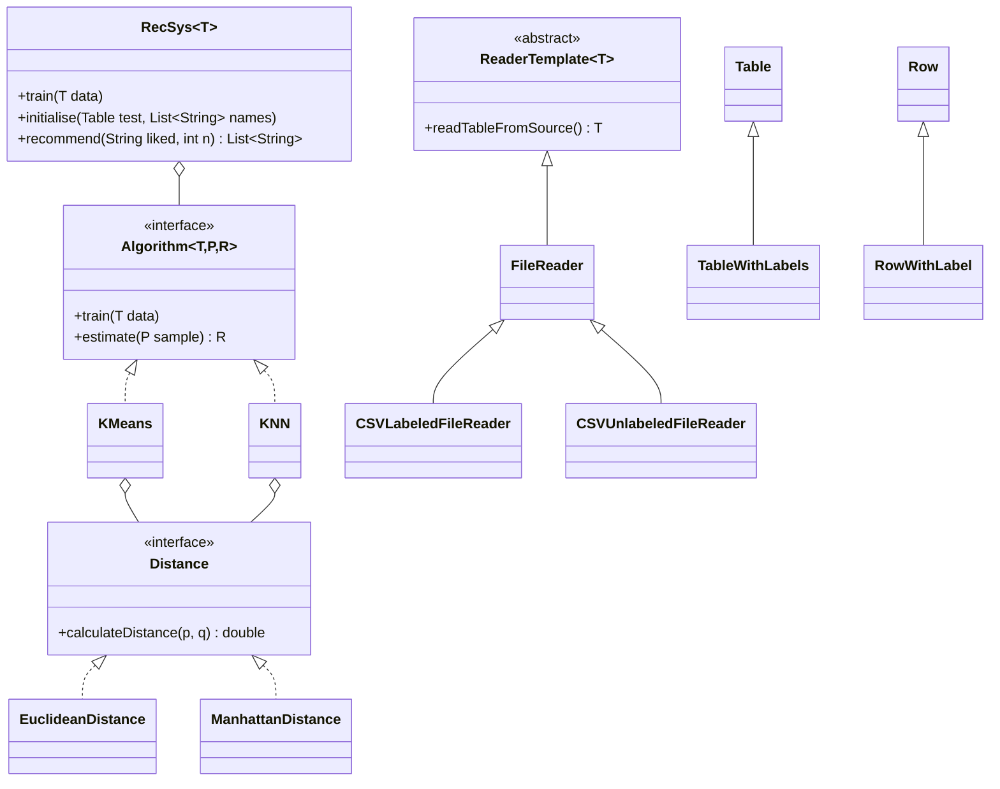

# Song Recommender (JavaFX)

A desktop app that recommends songs similar to one you pick. It uses **K-Means clustering** or **k-nearest neighbours** over 12 audio features (danceability, energy, tempo, valence…). Both algorithms are implemented from scratch in Java, with no ML libraries.

<!-- Add a screenshot: save it as docs/screenshot.png and uncomment the next line -->
<!--  -->

> University project for **Programación Avanzada** (2nd year, Computer Engineering, Universitat Jaume I), 2024–25.
> Pair project by **Robert Valentín Moldovanu** and **Daniel Salafranca López**.

## Features

- Choose a song from the list of ~850 tracks and get N recommendations.
- Switch between **K-Means** (15 clusters) and **KNN**, and between **Euclidean** and **Manhattan** distance, at runtime.
- History of searched songs.
- Background colour themes.
- Response time shown for every recommendation. Each model is trained once and cached, so later queries take under 1 ms.

## How it works

The dataset has ~3,400 training songs and ~850 test songs. Each song is a vector of 12 normalised audio features, and each training song is labelled with one of 15 genres (trap, techno, hardstyle, dnb, RnB…).

| Algorithm | Training | Estimation for a song |
|-----------|----------|-----------------------|
| **K-Means** | Groups the training songs into 15 clusters (random initial centroids with a fixed seed, 10 iterations) | Index of the closest centroid |
| **KNN** | Stores the labelled training set | Majority genre among the *k* nearest songs (k = 1 by default) |

`RecSys` estimates a group for every test song. When you pick a song, it returns other songs in the same group, excluding the one you picked.

## Design

The project follows **MVC** and uses a few classic design patterns:

- **Strategy**: `RecSys` depends only on the `Algorithm` interface, so `KMeans` and `KNN` are interchangeable. The `Distance` interface works the same way for `EuclideanDistance` and `ManhattanDistance`.
- **Template Method**: `ReaderTemplate` defines the steps for reading a CSV (open → headers → rows → close), and `CSVLabeledFileReader` / `CSVUnlabeledFileReader` fill in the parsing.



```
src/main/java/com/uji
├── MainApp.java          # JavaFX entry point
├── model/
│   ├── algorithms/       # Algorithm, KMeans, KNN
│   ├── distances/        # Distance, Euclidean, Manhattan
│   ├── dataStructure/    # Table, Row (+ labelled versions)
│   ├── filesManagement/  # CSV readers (Template Method)
│   ├── recSys/           # RecSys
│   └── models/           # SongModel, HistoryModel
├── view/                 # JavaFX views
└── controller/           # Controllers wiring views ↔ model
```

## Running it

Requirements: **JDK 21+** and **Maven**. JavaFX is downloaded by Maven.

```bash
git clone https://github.com/robertvalentinmol/song-recommender-javafx.git
cd song-recommender-javafx
mvn javafx:run      # launch the app
mvn test            # run the unit tests
```

## Tests

JUnit 5 tests cover the data structures, CSV readers, both distance metrics, KMeans and KNN (on the Iris dataset), and the recommender itself (results have the right size, never include the liked song, and unknown songs raise an exception).

## Tech stack

Java 21 · JavaFX 21 · Maven · JUnit 5
